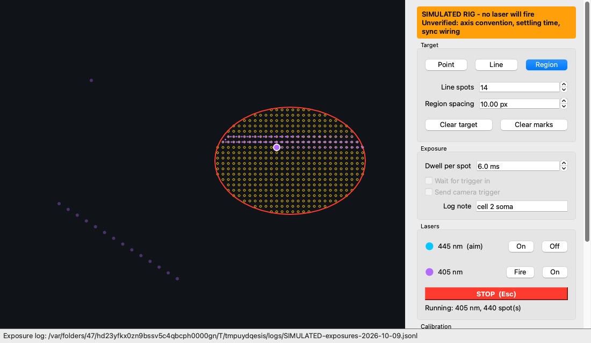
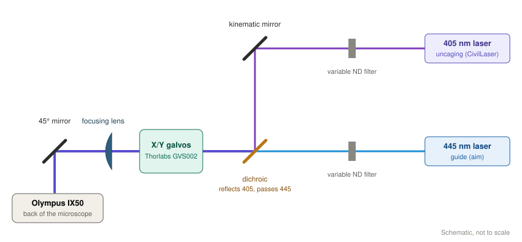
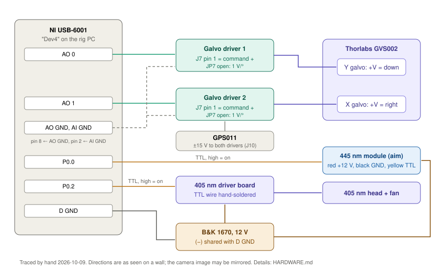
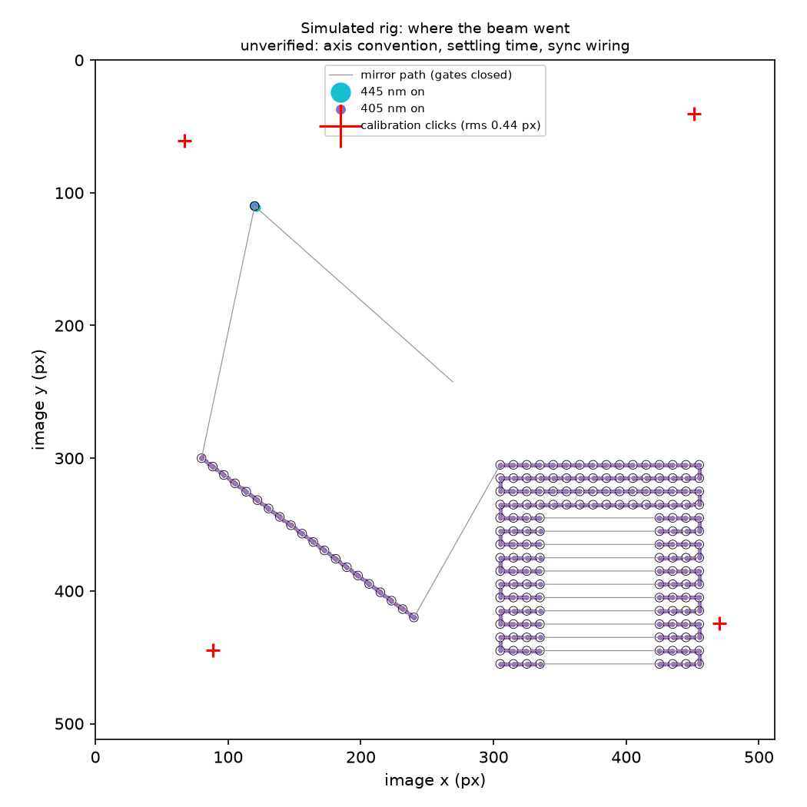

# Galvo photolysis controller

Control software for a UV spot-photolysis rig: two galvanometer mirrors steer a laser
beam to chosen points in a microscope field to photo-release (uncage) caged messengers,
such as caged IP₃, exactly where and when you want, while you image the response.



## What it does

- **Target by clicking on the image**: a point, a line of spots, or a filled region
  (scanned in alternating rows, closing the shutter across any gaps).
- **Calibrate in a minute**: the visible guide laser is sent to five positions and
  you click where its spot appears; an affine fit maps image pixels to mirror voltages,
  absorbing any rotation or mirror-flip in the optics.
- **Aim, then uncage**: the guide laser follows the crosshair while on; the uncaging
  laser fires only at the target and never sweeps across the field between targets.
- **Log every exposure**: time, laser, targets in pixels and volts, when the shutter
  opened and closed, and which calibration was in force, to one line per exposure, so
  photolysis can be matched to the imaging data afterwards.
- **Run without hardware**: a built-in simulator models the mirrors (voltage limits,
  update rate, settling time) so everything can be developed and demonstrated on any
  computer, including a Mac.

## Who made what

- **Hardware.** I (Ian F Smith) specified, procured and built the original photolysis rig
  at UC Irvine, and integrated it into a commercial microscope with TTL voltage control.
- **Original software.** Written by **Brett Settle** as an undergraduate working for me:
  [BrettJSettle/GalvoController](https://github.com/BrettJSettle/GalvoController) (2016–2017).
- **This codebase.** A new implementation by me, not a port. Brett's code served as the
  specification of what the software must do. Where I kept one of Brett's approaches, the
  code says so. It was built with AI assistance (Claude Code), which I directed and
  reviewed.

## Used in published research

The original rig, running Brett Settle's original software, delivered the spot
photorelease of caged IP₃ in:

- Lock JT, Parker I, Smith IF (2016). Communication of Ca²⁺ signals via tunneling
  membrane nanotubes is mediated by transmission of inositol trisphosphate through gap
  junctions. *Cell Calcium* 60:266–272.
  [doi:10.1016/j.ceca.2016.06.004](https://doi.org/10.1016/j.ceca.2016.06.004)
- Dickinson GD, Ellefsen KL, Dawson SP, Pearson JE, Parker I (2016). Hindered cytoplasmic
  diffusion of inositol trisphosphate restricts its cellular range of action.
  *Science Signaling* 9:ra108.
  [doi:10.1126/scisignal.aag1625](https://doi.org/10.1126/scisignal.aag1625)

This repository is a new implementation for the same rig. It was not used to collect
the data in those papers.

## The rig

An Olympus IX50 inverted microscope with a Thorlabs GVS002 two-axis galvo scanner,
driven by an NI USB-6001, and two diode lasers gated by TTL: a 445 nm guide laser,
whose spot is visible through Cal-520 fluorescence, and a 405 nm uncaging laser. A
dichroic combines the two beams before the scanner.





[`HARDWARE.md`](HARDWARE.md) records every connection, setting and measurement, each
marked as verified on the rig or not. [`config/rig.toml`](config/rig.toml) is the one
file the software reads those facts from.

## Design

- **One hardware interface, two implementations.** The rest of the code talks to "a
  DAQ" in volts and on/off lines; a simulator and the real NI-DAQmx driver both fit
  behind it. The simulator is never used silently, and every log entry names which
  one ran.
- **One coordinate chain.** Image pixels → (calibration) → mirror angles → (axis
  settings) → channel volts. Each step happens in exactly one place.
- **Plan, then execute.** Each exposure is first planned as a list of steps (move,
  settle, open, scan, close) that can be checked and tested without hardware. The
  plan is then run, and what actually happened is timestamped and logged.
- **Safety rules enforced in code:** out-of-range targets are refused, never clamped;
  the uncaging laser is off whenever the mirrors jump; a shot will not start while a
  laser is on; every laser line is driven low on connect, on stop, on error and on exit.
- Python 3.12 with PySide6 (Qt), type-checked (`mypy --strict`), with tests run on
  macOS, Windows and Linux for every change.



## Running it

**Simulator (macOS, Windows or Linux):** with [uv](https://docs.astral.sh/uv/) installed,

```bash
uv sync --extra demo
uv run galvo          # the targeting window, on the simulated rig
uv run galvo-demo     # headless demo: writes a log and the picture above
uv run pytest         # the test suite
```

In simulation the beam deliberately misses the target until you calibrate, as an
uncalibrated rig would.

**On the rig (Windows):** install [NI-DAQmx](https://www.ni.com/downloads) (which
includes NI MAX), download this repository, then double-click **`setup.bat`** once and
**`start-rig.bat`** to run. Close NI MAX test panels first: only one program can control
the DAQ at a time.

## Laser safety

This software drives Class 3B (or higher) lasers. It is not a safety system. Wear eyewear rated
for the wavelengths in use, keep beams enclosed or terminated, and switch the laser
supply on only after the software is running. On this rig the 405 nm driver turns on if
its control line is left undriven (see `HARDWARE.md`).

## Status

Working on the rig (October 2026): targeting, aiming, calibration and laser control.
Still to do: measuring galvo settling time on the hardware, camera trigger wiring,
and a Windows installer.

## License

MIT. See [LICENSE](LICENSE).
